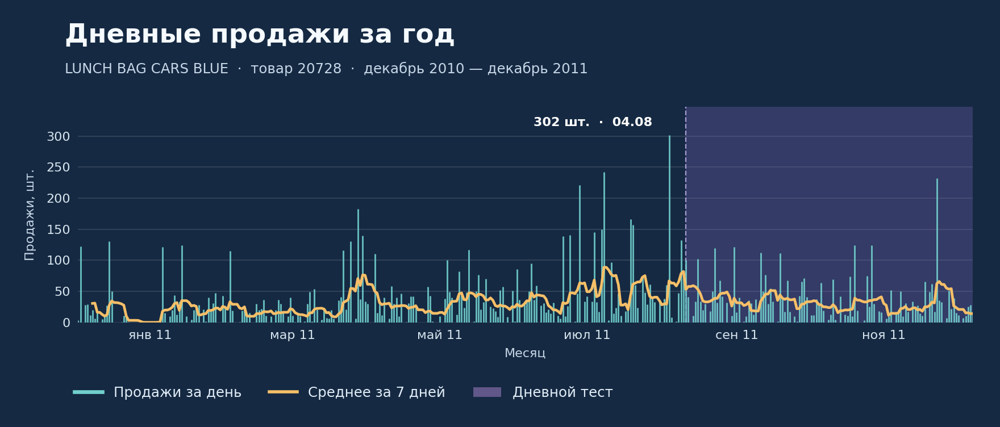
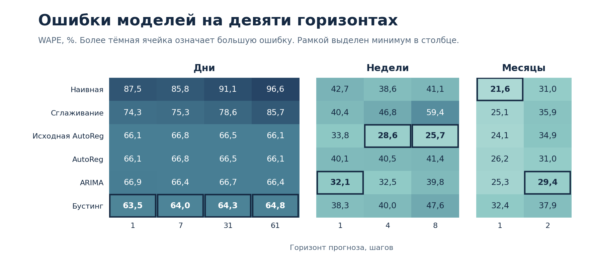

# Домашние работы по временным рядам

Как менялись продажи сумки **LUNCH BAG CARS BLUE** и насколько точно их можно предсказать? В первой работе разбираю данные Online Retail, во второй проверяю прогнозы на день, неделю и месяц.

| Работа | Что внутри | Ноутбук |
| --- | --- | --- |
| [homework_1](homework_1/README.md) | Очистка транзакций, сезонность и подготовка рядов | [Анализ данных](homework_1/analysis.ipynb) |
| [homework_2](homework_2/README.md) | Пять методов прогнозирования на девяти горизонтах | [Прогноз продаж](homework_2/forecast.ipynb) |

## Результаты прогнозирования

Бустинг показал наименьшую ошибку на всех дневных горизонтах. На 4 и 8 недель лучше сработала исходная AutoReg.

[Графики факта и прогноза и подробные результаты ДЗ № 2](homework_2/README.md#примеры-прогнозов)
