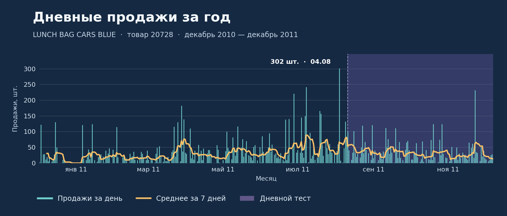
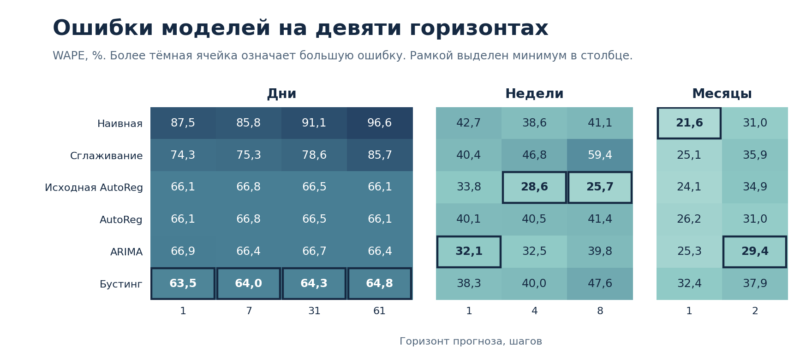
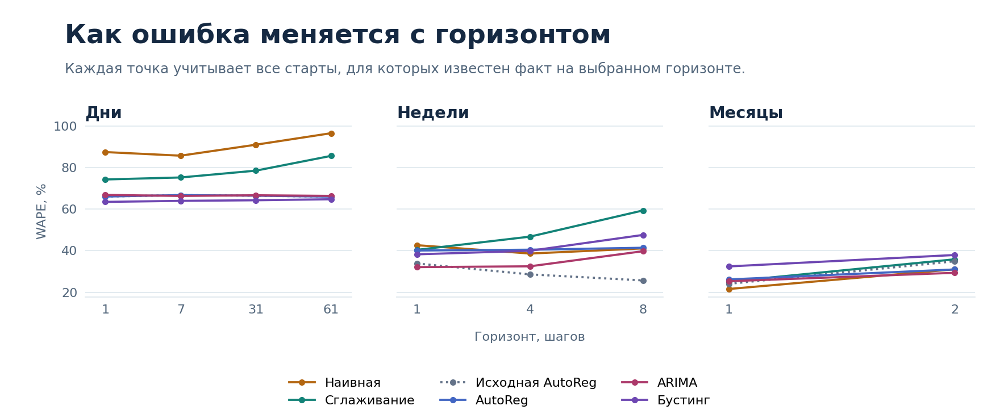
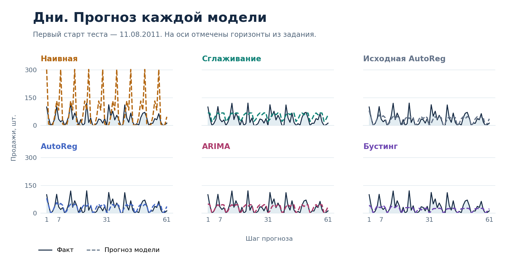
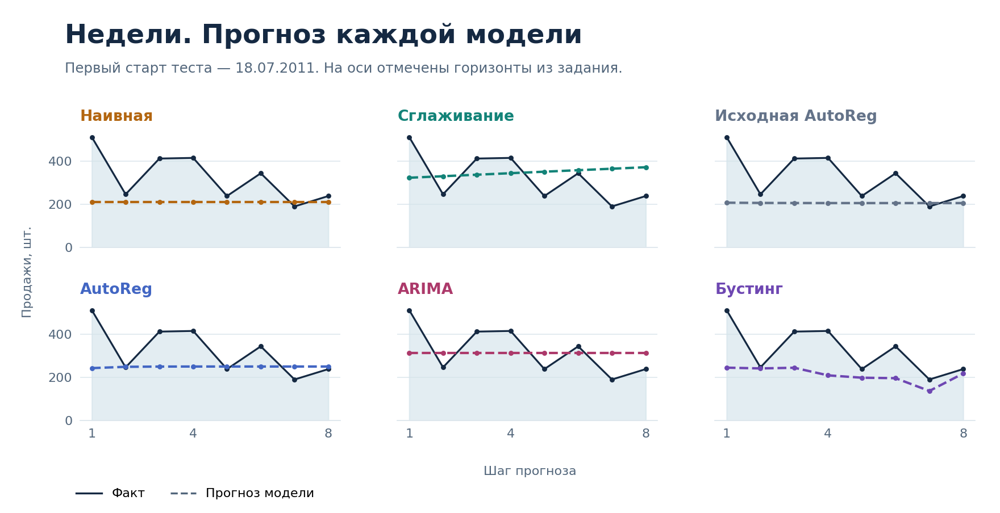
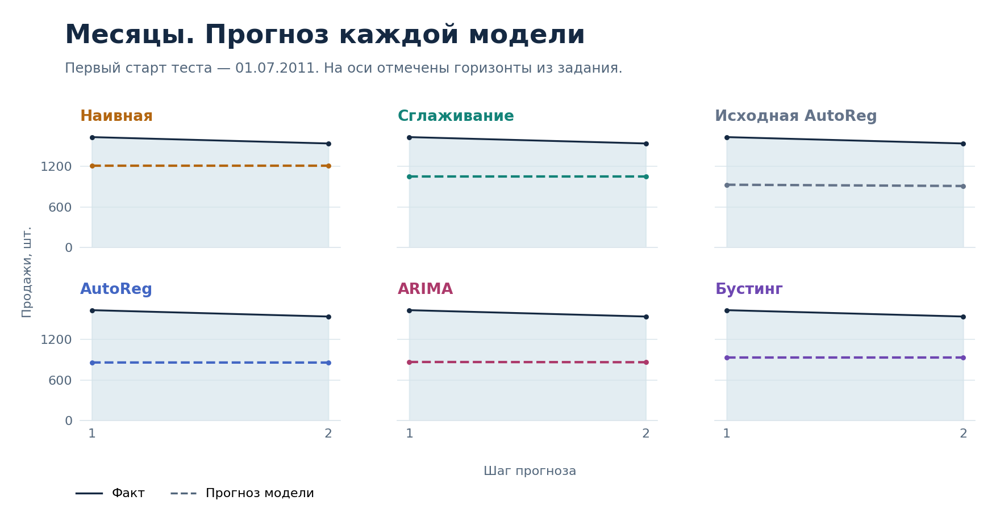
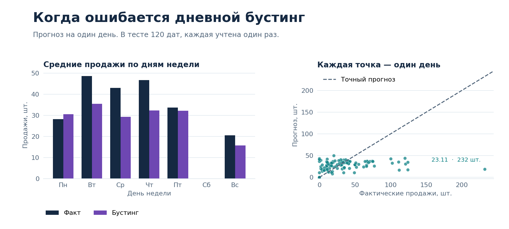

# ДЗ № 2. Прогноз продаж Online Retail

Прогнозирую продажи сумки **LUNCH BAG CARS BLUE** в штуках. Три ряда взяты из [ДЗ № 1](../homework_1/README.md). [Открыть ноутбук с экспериментами](forecast.ipynb)

## Сравнение моделей

Сравниваю наивную модель, экспоненциальное сглаживание, AutoReg, ARIMA и бустинг. Для AutoReg показываю исходный вариант и вариант с подбором параметров. Модели получают одинаковые даты старта. В тесте 120 дней, 20 недель и 5 месяцев. Параметры для дней и недель подбираю до теста.

У дневного бустинга с 300 деревьями WAPE растёт с **63,52%** на один шаг до **64,79%** на 61 шаг. На неделях лидируют ARIMA на одном шаге и исходная AutoReg на четырёх и восьми. Для месяцев есть всего 4–5 стартов.

Точные значения WAPE и число стартов

| Частота | Горизонт | Стартов | Лучшая модель | WAPE, % | Исходная AutoReg, % |
| --- | ---: | ---: | --- | ---: | ---: |
| День | 1 | 120 | Бустинг | 63,52 | 66,09 |
| День | 7 | 114 | Бустинг | 64,02 | 66,79 |
| День | 31 | 90 | Бустинг | 64,31 | 66,49 |
| День | 61 | 60 | Бустинг | 64,79 | 66,05 |
| Неделя | 1 | 20 | ARIMA | 32,11 | 33,84 |
| Неделя | 4 | 17 | Исходная AutoReg | 28,60 | 28,60 |
| Неделя | 8 | 13 | Исходная AutoReg | 25,71 | 25,71 |
| Месяц | 1 | 5 | Наивная | 21,57 | 24,07 |
| Месяц | 2 | 4 | ARIMA | 29,37 | 34,92 |

## Примеры прогнозов

Все шесть вариантов начинают прогноз в одну дату внутри каждой частоты. По горизонтальной оси можно найти нужный шаг. На дневном графике видно, как наивная модель каждую неделю повторяет пик из обучающего ряда.

Недельный прогноз на 1, 4 и 8 шагов

Месячный прогноз на 1 и 2 шага

## Ошибки дневного бустинга

По субботам и фактические продажи, и средний прогноз близки к нулю. Самый большой пик теста модель пропустила. На 23 ноября она ожидала около 19 штук, фактически продали 232.

## Запуск

В папке `homework_2` установите зависимости через `python -m pip install -r requirements.txt`. Откройте [forecast.ipynb](forecast.ipynb) и запустите все ячейки на Python 3.13. Готовые ряды читаются из `homework_1/data/processed`.

- [Метрики](results/metrics.csv), [прогнозы и факты](results/predictions.csv), [подбор параметров](results/validation.csv).
